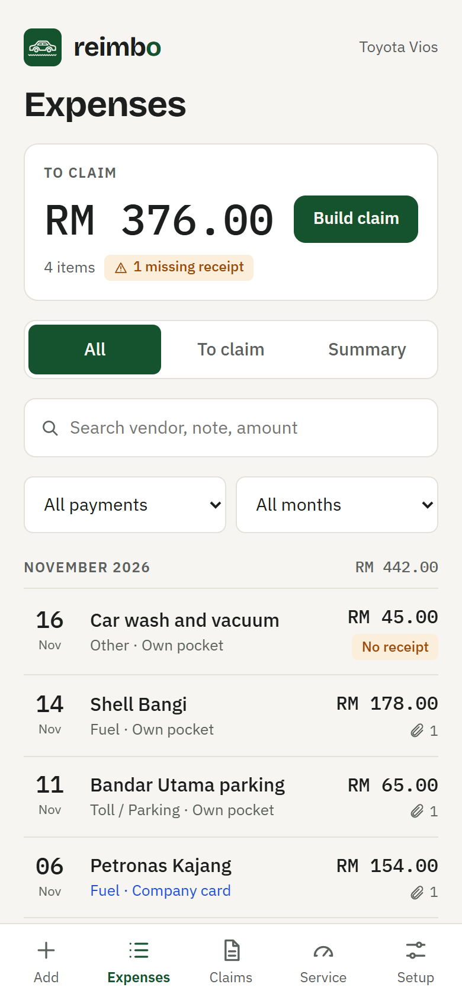
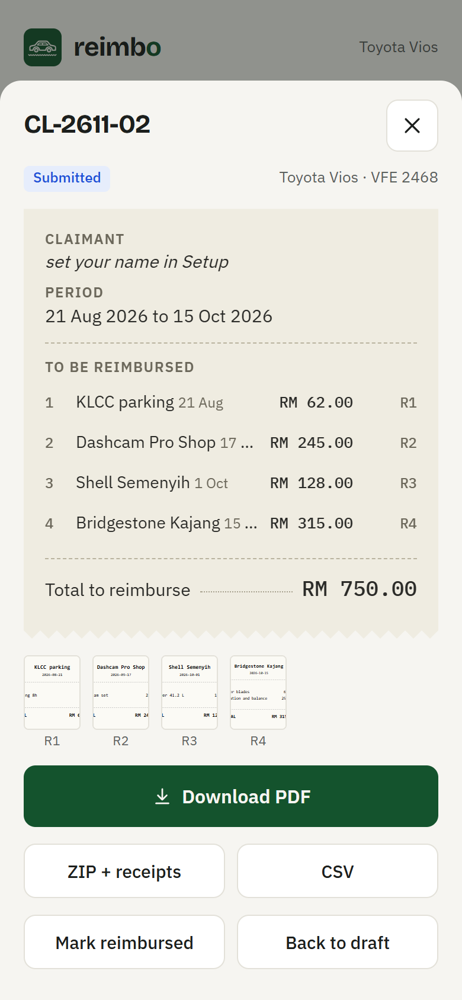
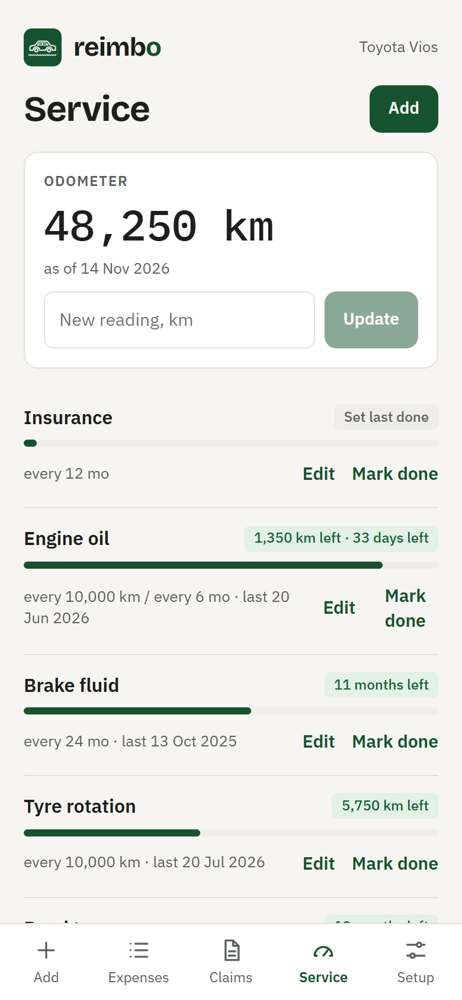
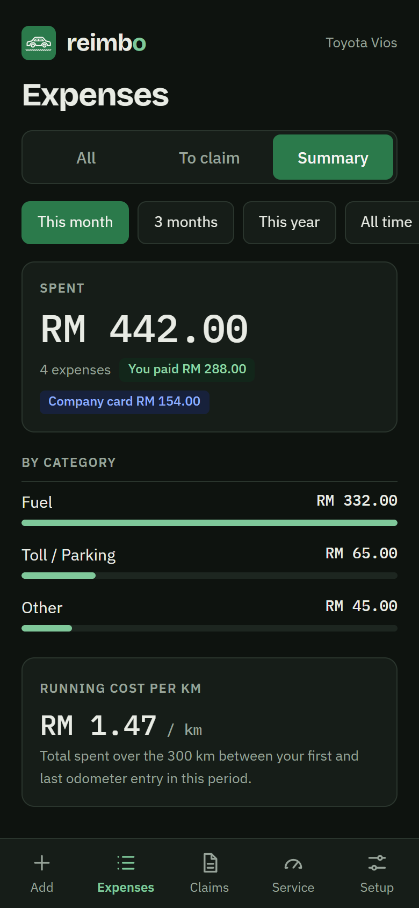
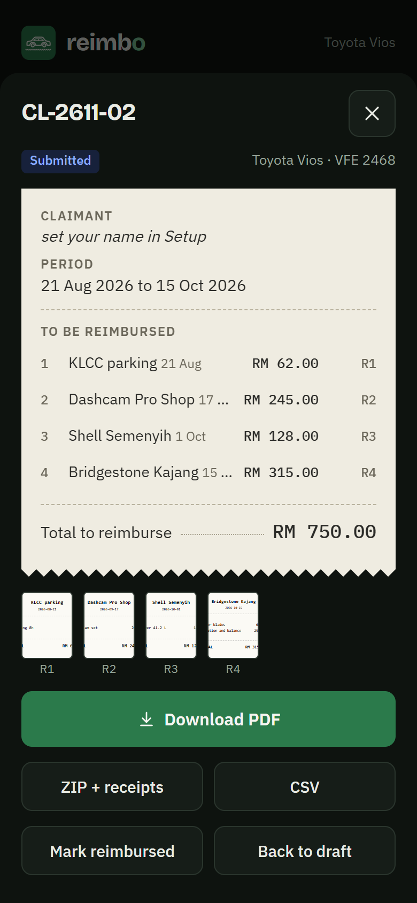
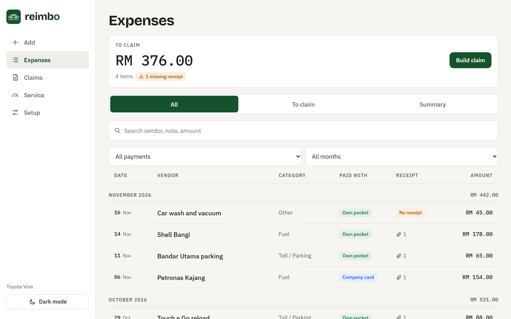

# Reimbo

A car expense tracker and claim report builder. Snap a receipt, log the spend, and turn a month of expenses into a clean PDF claim with every receipt attached.

Runs entirely on the Cloudflare free tier. No servers to maintain and nothing to pay for.

## Why

Company car costs (servicing, parts, add-ons, fuel, tolls) get paid in a mix of ways: my own pocket, a company card, sometimes both in one month. Claiming back the right ones means digging through receipts and spreadsheets. Reimbo keeps it all in one place and does the paperwork.

## Screenshots

Fictional demo data. Light and dark themes follow the phone setting.

| Expenses | Summary | Claim and receipts | Service |
| --- | --- | --- | --- |
|  |  |  |  |
|  |  |  |  |

Desktop:



## Features

- **Fast capture:** add an expense in seconds from the phone, with receipt photos (compressed before upload).
- **Mixed payment methods:** every method is marked claimable or not. Company-card spend is still listed, but kept out of the reimbursable total.
- **Multiple cars:** company car now, personal car later, each with its own expenses and service history.
- **Claims:** pick unclaimed items, build a claim, track draft / submitted / reimbursed. Exports a PDF report (items table, totals, every receipt as a numbered appendix), a CSV, and a ZIP of receipts. Items in a submitted claim are locked.
- **Search and summary:** search by vendor, note, category or amount. Spend by category and month, plus running cost per km from odometer readings.
- **Service reminders:** by km or date, with an in-app banner and a daily email.
- **Works offline:** expenses added with no signal are saved on the phone (IndexedDB, photos included) and upload automatically when back online.
- **Installable PWA:** add to the home screen on Android and iOS, light and dark themes.
- **Security:** rate-limited login, optional TOTP two-factor with backup codes and a "trust this device" option, change password in the app, and reset by email (the reset still requires the 2FA code when 2FA is on).
- **Backups:** weekly automatic snapshot to R2 (last 8 kept), plus a one-tap ZIP download of all data and receipts, and a restore script.

## Tech stack

| Layer | Choice |
| --- | --- |
| Frontend | React 19, TypeScript, Vite, hand-written CSS (design tokens, light/dark) |
| API | Hono on a Cloudflare Worker |
| Database | Cloudflare D1 (SQLite), versioned migrations |
| File storage | Cloudflare R2 (receipts, backups) |
| PDF / ZIP | jsPDF and fflate, generated in the browser |
| Email | Resend API (reminders) |
| Auth | HMAC-signed session cookie, RFC 6238 TOTP written against Web Crypto |

See [docs/ARCHITECTURE.md](docs/ARCHITECTURE.md) for how the pieces fit together.

## Project layout

```
src/         React app (screens, offline queue, PDF builder)
worker/      Hono API: expenses, claims, service, 2FA, backup, reminders
migrations/  D1 schema, applied in order
scripts/     icon generator, restore tool, demo seeding, screenshots, test scripts
public/      manifest, service worker, icons
docs/        architecture notes and screenshots
PLAN.md      decisions, roadmap, what is done
```

## Roadmap

Tracked in [PLAN.md](PLAN.md). Next up: fuel tracking and a custom domain.

## License

MIT, see [LICENSE](LICENSE).
