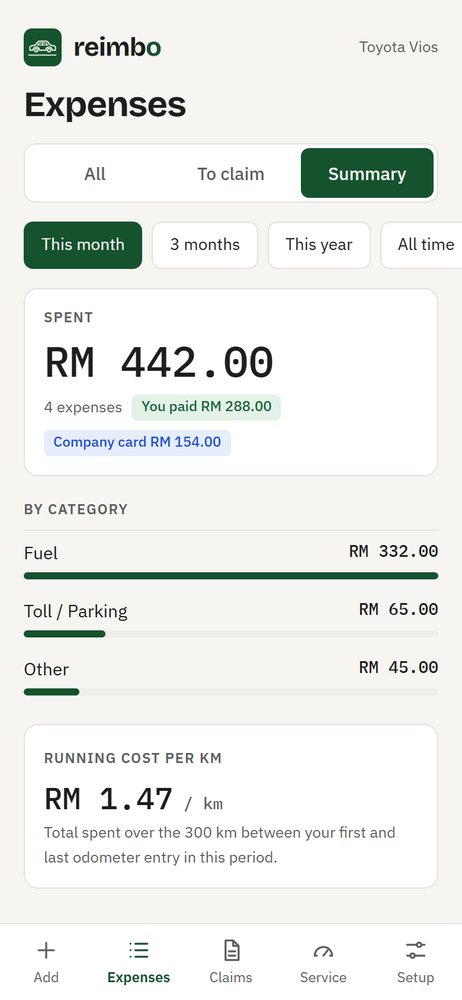
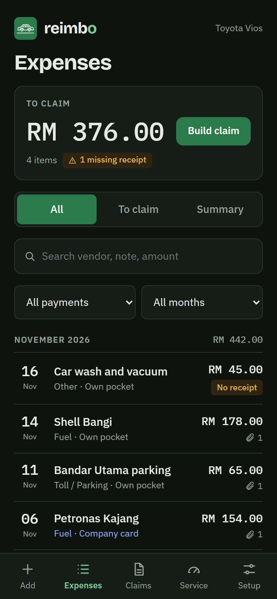
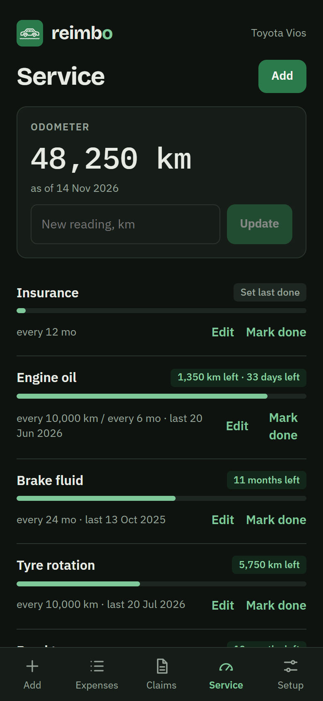

# Reimbo

A car expense tracker and claim report builder. Snap a receipt, log the spend, and turn a month of expenses into a clean PDF claim with every receipt attached.

Runs entirely on the Cloudflare free tier. No servers to maintain and nothing to pay for.

**Live demo:** https://reimbo.liewthesavage.workers.dev (private, single-user)

## Why

Company car costs (servicing, parts, add-ons, fuel, tolls) get paid in a mix of ways: my own pocket, a company card, sometimes both in one month. Claiming back the right ones means digging through receipts and spreadsheets. Reimbo keeps it all in one place and does the paperwork.

## Screenshots

Fictional demo data. Light and dark themes follow the phone setting.

| Expenses | Summary | Claim and receipts | Service |
| --- | --- | --- | --- |
|  |  |  |  |
|  |  |  |  |

Desktop:


## Features

- **Fast capture:** add an expense in seconds from the phone, with receipt photos (compressed before upload).
- **Mixed payment methods:** every method is marked claimable or not. Company-card spend is still listed, but kept out of the reimbursable total.
- **Multiple cars:** company car now, personal car later, each with its own expenses and service history.
- **Claims:** pick unclaimed items, build a claim, track draft / submitted / reimbursed. Exports a PDF report (items table, totals, every receipt as a numbered appendix), a CSV, and a ZIP of receipts. Items in a submitted claim are locked.
- **Search and summary:** search by vendor, note, category or amount. Spend by category and month, plus running cost per km from odometer readings.
- **Service reminders:** by km or date, with an in-app banner and a daily email.
- **Works offline:** expenses added with no signal are saved on the phone (IndexedDB, photos included) and upload automatically when back online.
- **Installable PWA:** add to the home screen on Android and iOS, light and dark themes.
- **Security:** shared password, rate-limited login (5 attempts per 15 minutes per IP), optional TOTP two-factor with backup codes and a "trust this device" option.
- **Backups:** weekly automatic snapshot to R2 (last 8 kept), plus a one-tap ZIP download of all data and receipts, and a restore script.

## Tech stack

| Layer | Choice |
| --- | --- |
| Frontend | React 19, TypeScript, Vite, hand-written CSS (design tokens, light/dark) |
| API | Hono on a Cloudflare Worker |
| Database | Cloudflare D1 (SQLite), versioned migrations |
| File storage | Cloudflare R2 (receipts, backups) |
| PDF / ZIP | jsPDF and fflate, generated in the browser |
| Email | Resend API (reminders) |
| Auth | HMAC-signed session cookie, RFC 6238 TOTP written against Web Crypto |

See [docs/ARCHITECTURE.md](docs/ARCHITECTURE.md) for how the pieces fit together.

## Run locally

```
npm install
cp .dev.vars.example .dev.vars   # set a local password
npm run db:local                 # create the local database once
npm run dev:api                  # API with local D1/R2 on http://localhost:8787
npm run dev:web                  # UI with hot reload on http://localhost:5173
```

Or serve the production build from the Worker alone: `npm run preview`, then open http://localhost:8787.

To try it on a phone on the same Wi-Fi, open `http://<laptop-ip>:8787`. Camera capture needs https on some browsers, so the deployed URL is the real test.

## Deploy

Step-by-step in [docs/DEPLOY.md](docs/DEPLOY.md). Short version: create a D1 database and an R2 bucket, put the database id in `wrangler.jsonc`, set the secrets, run `npm run db:remote` and `npm run deploy`.

## Project layout

```
src/         React app (screens, offline queue, PDF builder)
worker/      Hono API: expenses, claims, service, 2FA, backup, reminders
migrations/  D1 schema, applied in order
scripts/     icon generator, restore tool, demo seeding, screenshots, local test scripts
public/      manifest, service worker, icons
docs/        architecture and deployment notes
PLAN.md      decisions, roadmap, what is done
```

## Tests

There is no framework yet. `scripts/` has Node scripts that exercise the real Worker running under `wrangler dev`:

```
node scripts/test-2fa.mjs        # login, rate limit, TOTP, backup codes, replay protection
node scripts/test-backup.mjs     # backup, restore round trip, scheduled R2 snapshot
node scripts/test-reminders.mjs  # reminder email logic and duplicate protection
```

Start `npm run dev:api` first. The reminder script needs `RESEND_API_KEY` and `REMINDER_EMAIL` in `.dev.vars`.

## Regenerating the screenshots

With a fresh local database and `npm run dev:api` running:

```
node scripts/seed-demo.mjs                 # fictional car, expenses, claims, reminders
npm i --no-save puppeteer-core
node scripts/screenshots.mjs               # writes docs/screenshots/*.png (needs Chrome)
```

## Roadmap

Tracked in [PLAN.md](PLAN.md). Next up: fuel tracking and a custom domain.

## License

MIT, see [LICENSE](LICENSE).
